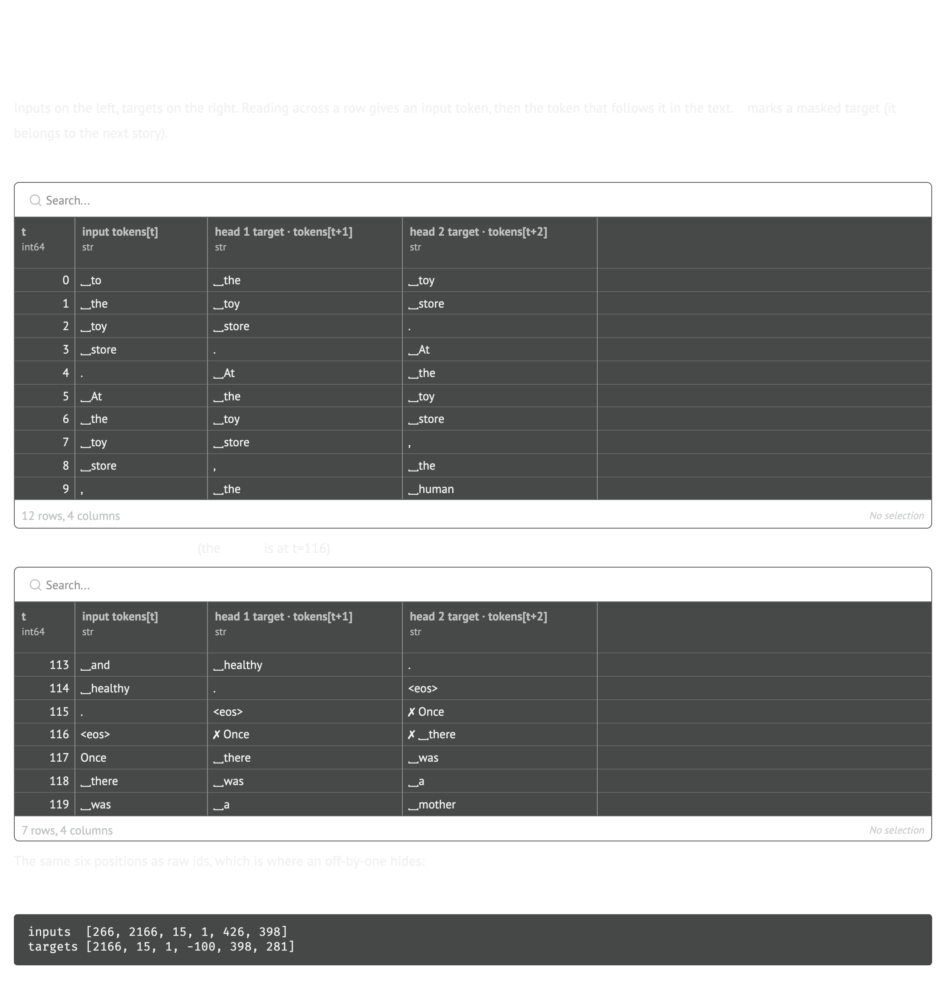
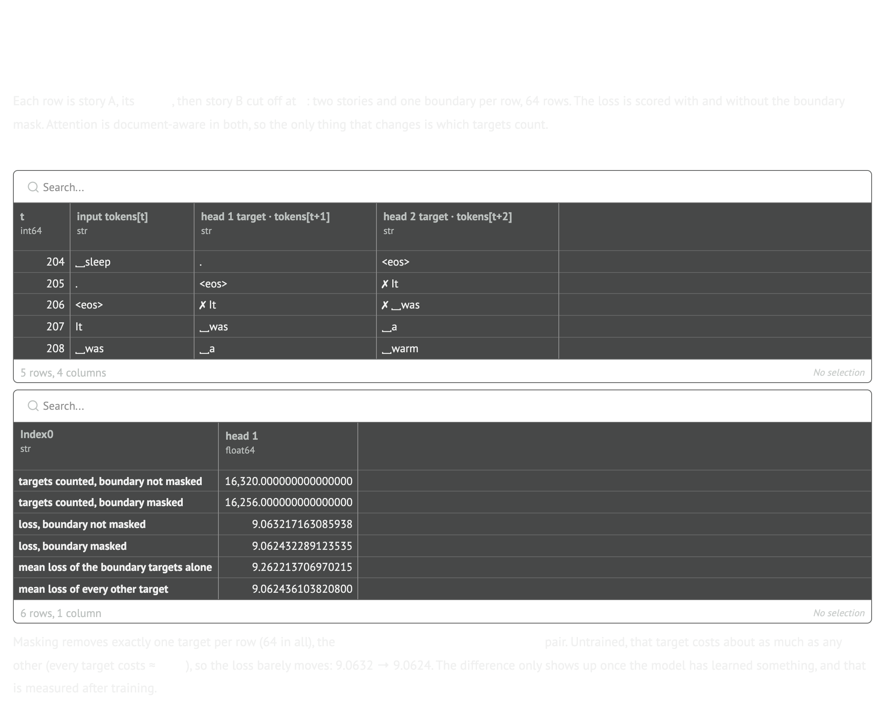
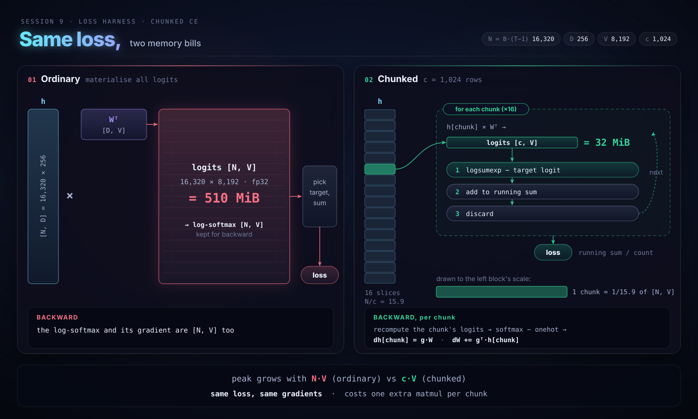
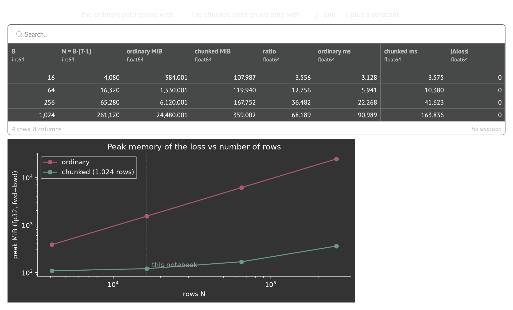
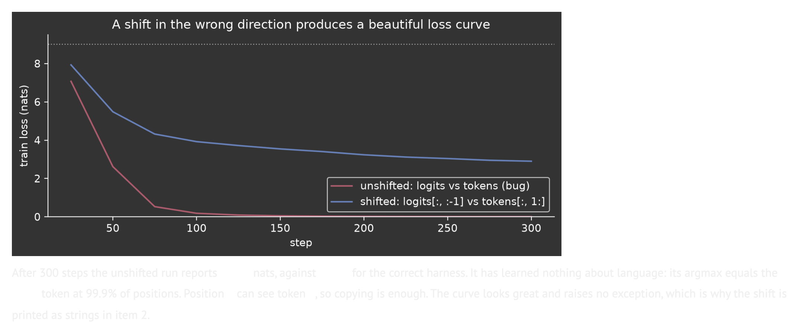
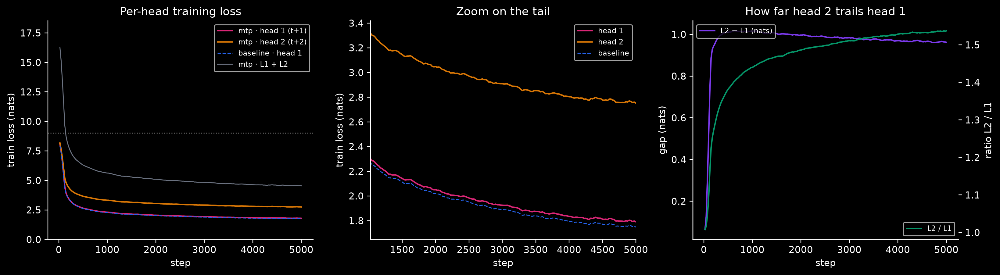
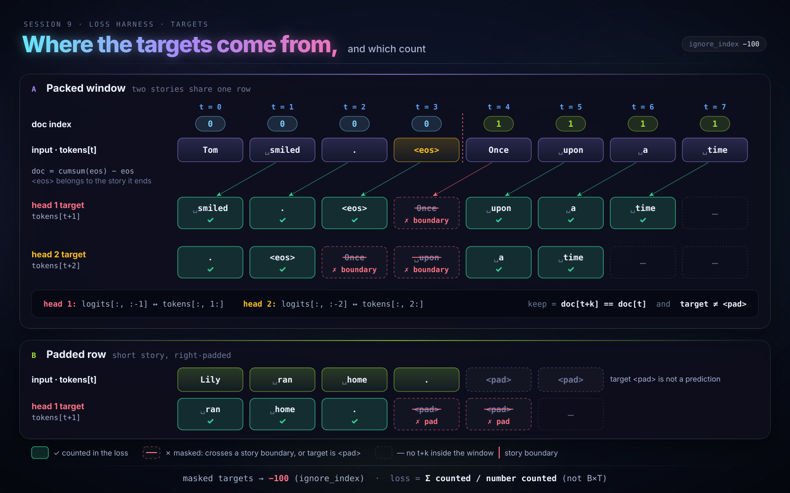
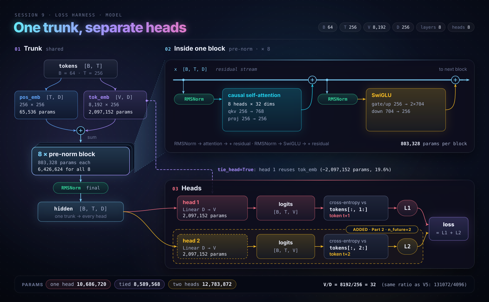

# LLM loss harness + multi-token prediction, from scratch

A small GPT (8 layers, 8 heads, `D=256`, BPE vocabulary `V=8,192`, context `T=256`) trained on TinyStories, used as a test bench for the few lines between `model(tokens)` and the scalar loss, where many silent training bugs live. Part 1 makes that path correct and observable: the shift, padding and packing masks, perplexity at init, tied vs untied heads, and a chunked cross-entropy that cuts the loss's peak memory 12.8×. Part 2 adds a second output head that predicts token `t+2` from the shared trunk (parallel multi-token prediction, as in [Gloeckle et al., 2024](https://arxiv.org/abs/2404.19737)), and measures what it costs and what it buys.

*Built as the Session 9 assignment of The School of AI's ERA V5 course.*

| | |
|---|---|
| **Notebook (runs top to bottom, outputs saved)** | [`loss_harness.ipynb`](loss_harness.ipynb) · [Open in Colab](https://colab.research.google.com/github/revantg/llm-loss-harness-multi-token-prediction/blob/main/loss_harness.ipynb) |
| marimo source (the notebook was built in marimo) | [`loss_harness.py`](loss_harness.py) |
| Interactive HTML export | [`exports/loss_harness.html`](exports/loss_harness.html) · [view rendered](https://revantg.github.io/llm-loss-harness-multi-token-prediction/exports/loss_harness.html) |
| Other exports (Git LFS) | [`exports/`](exports/): PDF, full-page PNG, marimo `.ipynb`, Markdown, JSON |

Hardware for the reported run: NVIDIA RTX PRO 6000 Blackwell (95 GiB), bf16 autocast, 5,000 optimizer steps per training run, `B=64`. Each 5,000-step run takes about 1.5–2 minutes on that GPU.

---

## Part 1 · The seven numbers

| # | Check | Result |
|---|---|---|
| 1 | Every tensor shape | `tokens [64, 256]` → `hidden [64, 256, 256]` → `logits [64, 256, 8192]` → loss inputs `[16,320, 8192]` vs targets `[16,320]` → scalar |
| 2 | The shift, printed as strings | inputs and targets line up one token apart; the `<eos> → next story` target is shown as `✗` (masked) |
| 3 | Padding: tokens contributing to the loss | **16,320 → 10,852** once `<pad>` targets are masked (33.4% of a padded batch is `<pad>`) |
| 4 | Packing: loss before → after masking the story boundary (trained model, head 1) | **2.0400 → 1.9990**. A boundary target costs 12.46 nats against 2.00 for every other target. Untrained: 9.0632 → 9.0624 |
| 5 | Perplexity of the untrained model | **8,693** against `V = 8,192` (loss 9.0702 vs `ln V = 9.0109`) |
| 6 | Output-layer parameters, tied vs untied | **8,589,568 vs 10,686,720**. Tying saves `V·D = 2,097,152` (19.6%). One head is 2.6× a whole transformer block |
| 7 | Peak memory of the loss, ordinary vs chunked cross-entropy | **1,530.0 MiB vs 119.9 MiB, 12.8× less**, with identical loss and gradients (`|Δloss| = 0`). At `B=1024` the saving is 68× |

### The shift, as strings (item 2)



### Packing across a story boundary (item 4)

Head 1 loses one target per row at the boundary. Head 2 loses two, because both `<eos>` and the token before it reach into the next story.



### Chunked cross-entropy (item 7)

The ordinary path keeps about three `[N, V]` buffers alive (logits, saved log-softmax, its gradient). The chunked path never materialises `[N, V]`: it processes 1,024 rows at a time and recomputes in backward.




### The warning, reproduced on purpose

**A shift in the wrong direction produces a beautiful loss curve.** Scoring `logits` against `tokens` (no shift) trains to **0.009** nats in 300 steps, against 2.902 for the correct harness. The model learned nothing: its argmax equals the *input* token at 99.9% of positions.



**Counting `<pad>` in training** reports a loss of 1.774 against 2.329 for the masked run, which looks 0.56 nats better. On real tokens the two models score 2.026 and 2.009. `<pad> → <pad>` is free to predict, so it drags the mean down.

---

## Part 2 · One extra head

A second untied head `Linear(D, V)` on the same trunk predicts `tokens[t+2]`. Training minimises `L1 + L2`. Both runs below use the same seed, the same batches, and the same 5,000 steps.

### The two losses (final validation, 60 fixed batches)

| | Head 1 (`t+1`) | Head 2 (`t+2`) | Sum |
|---|---:|---:|---:|
| **mtp loss** | **1.8955** | **2.8931** | 4.7886 |
| perplexity | 6.66 | 18.05 | |
| top-1 accuracy | 54.8% | 38.3% | |
| baseline (one head) | 1.8565 | | |



| step | L1 | L2 | L2 − L1 | L2 / L1 |
|---:|---:|---:|---:|---:|
| 1 | 9.029 | 9.038 | 0.009 | 1.00 |
| 250 | 3.098 | 4.097 | 0.999 | 1.32 |
| 500 | 2.678 | 3.713 | 1.035 | 1.39 |
| 1,000 | 2.362 | 3.398 | 1.035 | 1.44 |
| 2,000 | 2.133 | 3.159 | 1.026 | 1.48 |
| 3,000 | 2.013 | 3.027 | 1.014 | 1.50 |
| 4,000 | 1.935 | 2.939 | 1.004 | 1.52 |
| 5,000 | 1.898 | 2.895 | 0.998 | 1.53 |

### What happens to the second head's loss, and why

**What we see.** Both heads start at `ln V ≈ 9.01` with no gap. The gap opens very fast: it reaches 90% of its final size by step 100. It peaks at 1.04 nats around step 750 and then stays almost exactly flat: 1.00 at step 250, 1.00 at step 5,000. From step 250 on, head 1 and head 2 each fall by 1.20 nats. **Head 2 is not learning more slowly. It runs a fixed ~1 nat behind and never catches up.** Only the *ratio* `L2/L1` keeps rising (1.32 → 1.53), because L1 keeps falling while the gap does not.

**Why.** Head 2 must predict `t+2` without seeing `t+1`, so it has to spread its bet over every `t+1` that could come next. Its best achievable loss is `H(x_{t+2} | x_{≤t})`, which is at least `H(x_{t+1} | x_{≤t})`: the unseen token adds uncertainty that no amount of training can remove.

- In the first few dozen steps both heads learn only token frequencies. The frequency of the token at `t+2` is the same as at `t+1`, so the losses match.
- As soon as the model uses context, head 1 gains from the sharpest dependency in text, the one on the immediately preceding token (finishing a word or a fixed phrase: `" Once upon a" → " time"`). Head 2 gets only what survives one unseen token. That is the ~1 nat that opens early.
- After that, improvements to the shared trunk (who the story is about, what happened, grammar) help both heads about equally, so the gap stays flat instead of shrinking. The gap measures the extra entropy of looking two tokens ahead, not under-training.

**Effect on head 1.** With the extra head, head 1 ends at 1.8955 against 1.8565 for the single-head baseline (+0.039 nats). At this scale (about 6.4M trunk parameters, 5,000 steps) the trunk now serves two objectives, and the extra supervision does not pay for itself in next-token loss. The multi-token prediction literature reports its gains at much larger scale.

**As a draft head.** Used greedily for self-speculative decoding, head 2's guess for `t+2` matches what head 1 then predicts at that position **54.1%** of the time. That acceptance rate, not the loss, decides whether multi-token prediction pays off at inference.

---

## How the harness is built

- **Shift:** head `k` scores `logits[:, :-k]` against `tokens[:, k:]`.
- **Masks:** targets that are `<pad>`, or that belong to a different story than position `t`, are set to `-100` (`ignore_index`).
- **Mean:** summed loss divided by the number of targets that count, never by `B·(T−k)`.
- **Attention is document-aware:** a position attends only to earlier positions in the same story, matching the loss mask.




## Reproduce

```bash
pip install torch tokenizers huggingface_hub pyarrow pandas matplotlib marimo
jupyter nbconvert --to notebook --execute loss_harness.ipynb   # or: marimo edit loss_harness.py
```

Data: the first 400,000 stories of the TinyStories train split and 4,000 validation stories, downloaded from `roneneldan/TinyStories` on the Hugging Face Hub. The BPE tokenizer is trained in the notebook. The notebook uses bf16 autocast on CUDA and also runs on CPU (slowly).
